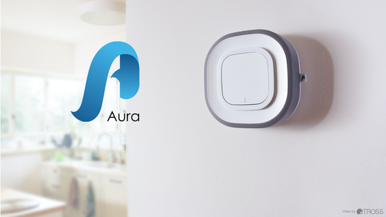
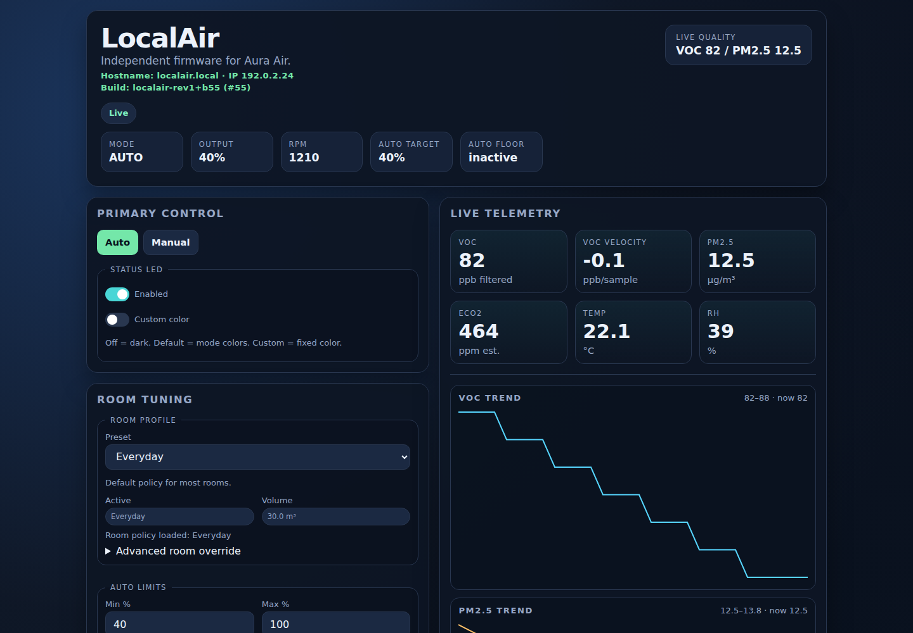
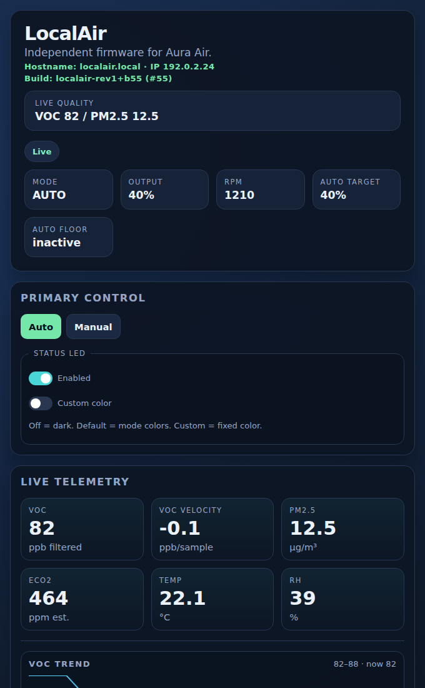
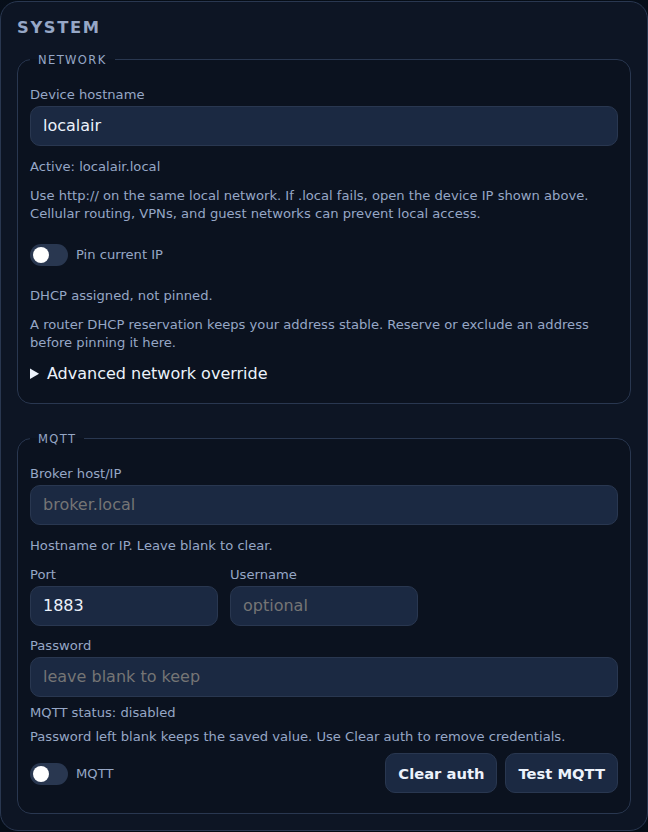

# LocalAir

*Custom local firmware for the Aura Air Rev 1.0.*

<p align="center">
  
</p>

*Remember this purifier? Aura Air's original crowdfunding campaign image.
[Source and image credit](docs/assets/original-aura-air.md).*

LocalAir provides local control for compatible Aura Air purifiers.
This independent project is not affiliated with or endorsed by the manufacturer.
It serves a local dashboard, REST API, SSE stream, MQTT state and commands, mDNS, and automatic fan control.

## Compatibility

> **Hardware scope:** This firmware targets F00053AA Aura Air Rev 1.0 only.
> Later Aura Air hardware, enterprise models, and rereleased devices are not supported.
> Do not flash this firmware to other hardware, it assumes a specific Particle P1 board layout, GPIO mapping, sensor topology, and daughter-board behavior.
> Flashing unsupported hardware may brick the device or cause unsafe actuator behavior.

**Field testing:** I ran LocalAir on two purifiers continuously for about six months before this release, and many v1.0.0 fixes came from problems that only appeared over that time.
I also bought a third, unused new-old-stock unit and flashed it from stock firmware to confirm that setup works on an untouched device.

**UV-C and sterionizer:** LocalAir switches the UV-C lamp and sterionizer on at boot and leaves them on while the purifier is powered.
There is no setting to turn them off.

**One-way install:** There is no published way to restore the original Aura firmware. Treat flashing LocalAir as permanent.

## Why This Exists

The Kickstarter-era F00053AA Aura Air Rev 1.0 shipped as a cloud-dependent
smart purifier. The original app and backend path stopped being a practical
ownership route, leaving functional hardware without reliable local control.

This project started as a hardware recovery effort. The Rev 1.0 controller uses
a Particle P1 module, and the first recovery path came from identifying that
module, recovering the device identifier, and proving the remaining callable
surface could still read diagnostics and change fan state. That work exposed a
remote handle into a stranded product.

LocalAir replaces that dependency with firmware that runs on the device:
an embedded dashboard, local REST/SSE APIs, MQTT publishing, mDNS discovery,
EEPROM-backed configuration, and deterministic fan control tailored to the
original Rev 1.0 electronics.

Particle integration remains enabled: the firmware registers cloud functions
and variables, and the documented OTA path uses Particle services. The local
HTTP dashboard/API has no application authentication or TLS; MQTT also uses
plain TCP. These interfaces are intended for a trusted LAN. Current source
does not establish every offline boot or clock-synchronization scenario.

The work grew from hardware recovery into firmware that Rev 1.0 owners can
inspect, configure, and maintain themselves. The public package includes the
source, dashboard, and helpers needed to build and flash it.

## Getting Started

Release **v1.1.0** includes a prebuilt binary, so you can flash your purifier
without setting up a compiler. The package version is `1.1.0`; the firmware
reports `localair-rev1+b61`, build **61**.

**First time?** Follow [First-time setup](docs/FIRST_TIME_SETUP.md). It covers
the purifier's buttons and status LED, creating a free Particle account,
finding the device ID, Wi-Fi, safe mode, claiming, and the first flash.

Flashing needs only the [Particle CLI](https://docs.particle.io/reference/developer-tools/cli/)
and three files from the
[v1.1.0 release](https://github.com/phatwila/LocalAir-Rev1/releases/tag/v1.1.0):
`localair-rev1.bin`, `SHA256SUMS`, and `release-info.json`. The Particle CLI
is available for Windows, macOS, and Linux. Download them into one folder and verify them there:

```bash
sha256sum -c SHA256SUMS           # Linux
shasum -a 256 -c SHA256SUMS       # macOS
```

On Windows, compare `Get-FileHash .\localair-rev1.bin` with `SHA256SUMS`.
The firmware binary is **121,244 bytes**, with SHA-256:

```text
b0cfaa6f53f033fb56cf3f4ae041c5bce3a5a791396b5bc785fd2a3bc56fa813
```

### OTA install

For a purifier claimed to your Particle account and online:

```bash
particle flash <device-id> localair-rev1.bin
```

The first flash also upgrades Device OS over the air. Expect rapid magenta
blinking and several restarts for 5–10 minutes. Then confirm the release:

```bash
particle get <device-id> FW_VER
particle get <device-id> BUILD_NUM
particle get <device-id> localIP
```

### USB install

Connect the purifier's micro-USB port with a data cable, then run:

```bash
particle flash --local localair-rev1.bin
```

The CLI switches the purifier to DFU mode and installs the Device OS it needs.
USB flashing still needs `particle login`, because the CLI downloads Device OS
from Particle, but the purifier does not need to be claimed. See the
[flashing guide](docs/FLASHING.md) for WSL notes and recovery.

Open `http://localair.local/` to use the dashboard. If your network cannot
resolve that name, open `http://<device-ip>/` instead. Your saved hostname or a
collision suffix may change the name; status reports it in `mdns_host`.
Keep your existing address and control settings, then check them after flashing.

## Documentation Map

Use these guides when you need more detail:

| Concern | Guide |
| --- | --- |
| Setting up a unit for the first time | [First-time setup](docs/FIRST_TIME_SETUP.md) |
| Downloading, verifying, flashing, and checking the device | [Flashing guide](docs/FLASHING.md) |
| Auto policy, sensor trust, and RPM interpretation | [Control loop](docs/AUTO_CONTROL_LOOP.md) |
| HTTP endpoints and command acceptance | [Public API](#public-api) |
| MQTT configuration, topics, and commands | [MQTT](#mqtt) |
| Building your own firmware | [Building from source](#building-from-source) |
| Contributions, security, and support | [Governance and support](#governance-and-support) |

## How LocalAir Controls Air

LocalAir gives the original Rev 1.0 hardware an inspectable local
pollution-control loop. In Auto, the firmware watches the particle sensor,
gas/VOC readings, and estimated ventilation signal, then uses the strongest
usable pollution signal to decide how hard the fan needs to work.

The firmware turns that signal into a bounded airflow target, matches it to the
configured room profile, optional room size, and min/max fan limits, then
quantizes it onto the fan's 1–16 step scale. These percentages describe policy
demand; airflow has not been measured. Final step selection prioritizes Manual,
startup, Schedule, then Auto. Auto limits constrain the applied step after slew;
they do not constrain Manual or Schedule requests.

HTTP status, SSE status, and MQTT state share a JSON status renderer. They can
report different observations because they publish at different times. Status
separates Auto demand, the selected fan command, and RPM feedback.

Manual is for deliberate owner control. Setting a fan percentage creates an
intentional override that sits above Auto and persists as the chosen control
state until the user returns the purifier to Auto. If a fan apply timeout,
apply failure, or backend loss ends Manual control, the firmware saves Auto, so
a reboot does not bring Manual back.

The schedule can select a fan percentage during a daytime or overnight window.
Manual takes priority over Schedule, which takes priority over Auto. Scheduling
does not overwrite saved Manual intent. Returning to Auto clears Manual intent;
an enabled schedule can then take over during its window.

Unusable sensor readings hold filter history. Invalid signals lose control
authority independently. Close pollution-lane changes require ten elapsed
seconds; clearly stronger signals can switch immediately. See the
[control loop](docs/AUTO_CONTROL_LOOP.md) for trust thresholds and recovery rules.

## Dashboard Preview

<p align="center">
  
</p>

LocalAir serves its dashboard from the purifier. The interface
shows live air quality, current control mode, fan demand, room tuning, schedule
settings, telemetry trends, and local system configuration.

### A complete dashboard in 16.2 KiB

The whole interface lives on the purifier. Its 79,770 bytes of HTML, CSS, and
JavaScript compress to **16,610 bytes**, saving **79.18%**. The firmware serves
that bundle directly from flash; your browser decompresses it. The interface
assets need no CDN or separate filesystem, and the device needs no runtime
compressor or full uncompressed page buffer.

The build runs the Python asset packer automatically:

```text
HTML + CSS + JavaScript → gzip → generated C array → ARM GCC → firmware flash
```

For interface changes, edit `src/web/dashboard.html` and rebuild.
The generated `src/web/dashboard.h` carries the compressed interface into the
firmware. Keep it with the source when sharing a build.

<p align="center">
  
  
</p>

These previews render the current dashboard with synthetic example data.

## Engineering Highlights

LocalAir uses its own automatic control algorithm.

LocalAir returns local, inspectable control to original Rev 1.0 owners on
constrained Particle P1-class hardware.

- Custom fixed-buffer web stack: the firmware serves the dashboard, REST API,
  SSE stream, debug routes, reboot endpoint, and control endpoints without an
  external web framework.
- Packed on-device dashboard: `src/web/dashboard.html` becomes a compact
  gzip blob served from flash. Source builds record the packing environment.
- Room-aware automatic control: `AutoEngineV3` uses room profile, optional room
  volume, fan bounds, pollutant inputs, and quantized actuation.
- Streaming request parser: browsers may send up to 8 KiB of headers, including
  cookies. Every line is validated, and only the framing headers are kept.
- Interruption-safe settings: two alternating checksummed copies keep the last
  complete save through a reset or power loss.
- Shared status contract: `/api/status`, `/stream`, and MQTT state use the same
  renderer. Configuration has its own HTTP response.
- Self-contained MQTT 3.1.1 support: state publishing and command parsing live
  in-tree without a vendored MQTT client.
- Minimal local discovery: the mDNS responder supports probing, collision
  suffixes, `_http._tcp.local`, and `.local` discovery for Particle P1 devices.
- Actuation diagnostics separate assumed module readiness, timestamped RPM
  feedback, and command history, so a recorded command is distinguishable from
  observed fan rotation.

## Current model

Public settings persisted across reboots are listed below. You can change them
through the dashboard or configuration API.
Internal estimator state and saved control intent are stored separately from
this public configuration response.

Settings are saved to two alternating, checksummed copies in emulated EEPROM.
A reset or power loss during a save leaves the previous copy intact. Factory
defaults load only when no stored copy is valid. The Kalman and baseline
estimator state is saved every five minutes in its own record and never
rewrites the settings copies.

- `room_profile`: room preset (`sleep`, `everyday`, `open_plan`).
- `room_m3`: optional room-size override.
- `min_fan_percent` / `max_fan_percent`: Auto demand bounds. Minimum accepts
  40–100, maximum accepts 1–100, and minimum must be strictly below maximum.
  At least one mapped fan step must fit the range. Applied Auto steps remain
  inside it; a range with no fitting step receives HTTP 400.
- `hostname_base`: mDNS base name, such as `localair` for `localair.local`.
  Collisions can add a suffix; status reports the actual name in `mdns_host`.
- `schedule_enabled`, `schedule_start_min`, `schedule_end_min`,
  `schedule_fan_percent`: daily window with an inclusive start and exclusive end.
  Overnight windows are supported; an enabled window cannot have equal endpoints.
- `led_enabled`, `led_custom_color_enabled`, `led_color_r/g/b`: status LED behavior.
- `timezone_offset_hours`: saved integer UTC offset, synced from the browser
  when the Schedule group saves. Fractional-hour offsets are rounded. This is
  not a named timezone; resave Schedule after a DST or timezone change.
- `mqtt_enabled`, `mqtt_broker_ip`, `mqtt_port`, `mqtt_user`, `mqtt_pass`:
  optional broker settings. GET reports `mqtt_pass_set` instead of the password.
  See [MQTT](#mqtt) for omission, clearing, and command behavior.
- `static_ip_enabled`, `static_ip`, `static_netmask`, `static_gateway`, `static_dns`: static IP pin.
  When enabled with IP or netmask unset, all four address values are captured
  from the current interface. Blank gateway/DNS alone does not trigger capture.
  Omitted JSON fields preserve saved values, including a previously pinned IP.
  Changes take effect on the next WiFi reconnect; disabling selects DHCP on
  that reconnect. Saving does not force reconnection or create a router reservation.
  At boot, if an enabled pin differs from the live address, the saved pin is
  re-applied once. A disabled pin is left unchanged.

Runtime behavior:

- `AutoEngineV3` is the internal automatic-control engine.
- Public firmware versions use `localair-rev1+bN`.
- Auto proposes `v3_quantized_step`; `v3_applied_airflow_pct` represents that
  model step. The command router selects the owning source's step for hardware.
  `control.speed` and `fan_percent` describe the recorded fan output command.
- Control is pollutant-driven and room-aware.
- `/api/status.control` always exposes `schedule_active` and `schedule_target_pct`; inactive schedules report `false` and `0`.
- `control.mode` is `"auto"`, `"schedule"`, or `"manual"`. Startup is described
  separately by `startup_active` and `startup_state`; it has no fourth mode string.

## Diagnosing Resets

`GET /api/debug/boot` reports why the device last reset and where its settings
loaded from:

- `reset_reason` and `reset_reason_name`: the Device OS reset reason, such as
  `power_down`, `pin_reset`, `update`, `panic`, or `user`. A reset forced by the
  application watchdog reports `app_watchdog`.
- `reset_data`: the Device OS reset data value.
- `config_load`: `ok` for the newest settings copy, `recovered` when a damaged
  copy was skipped, `legacy` for a one-time import from an older settings layout, or
  `defaults` when no stored settings were valid.
- `uptime_s`: seconds since boot.

The boot entry in `/api/events` carries the same summary, such as `boot r40 ok`.

## Reading the Feedback

`rpm_actual` is zero for unavailable or stale feedback.
Use `rpm_valid`, `rpm_fresh`, and `rpm_age_ms` together.
Sampling occurs every five seconds; valid samples remain fresh through
10,000 ms. A pulse-free sample can be valid zero without proving a stall.
Never-seen age is JSON `null`. Stale feedback can retain `rpm_valid:true`
while publishing `rpm_fresh:false` and `rpm_actual:0`.
Readiness includes assumed module presence and a settling timer;
it is not verified physical-cover detection.
eCO2 is estimated, and gas airflow demand is an uncalibrated policy.
RPM does not establish airflow or clean-air delivery.

## Public API

- `GET /` serves the embedded dashboard; `/index.html` is an alias.
- `GET /favicon.ico` returns 204 with no icon body.
- `GET /api/status` returns the public status JSON.
- `GET /api/config` returns public settings JSON, excluding secrets and internal estimator state.
- `POST /api/config` updates config from JSON.
- `POST /api/fan/speed` accepts a Manual step, 1 fastest through 16 slowest.
- `POST /api/fan/percentage` accepts a Manual percentage.
- `POST /api/fan/auto` clears Manual intent; Auto or an active schedule can take over.
- `GET /api/history?n=50` returns recent RAM readings, newest first. The default
  is 50, clamped to 1–200; history is lost on reboot.
- `POST /api/mqtt/test` probes MQTT connectivity.
- `GET /api/events` returns recent event-log entries.
- `POST /api/reboot` acknowledges, waits 200 ms, then requests a system reset.
- `GET /stream` provides the dashboard SSE feed.

Fan success means owner acceptance and persistence, not completed physical
actuation. Responses retain the accepted command's ID and requested values.
For example, `POST /api/fan/speed` with `{"speed":12}` returns HTTP 200:

```json
{"ok":true,"accepted":true,"command_id":123,"state":"accepted","mode":"manual","percentage":27,"speed":12}
```

The ID above is illustrative. A percentage body can be `{"percentage":30}`
or `{"value":30}`. HTTP clamps integer percentages to 0–100. **0% selects
step 16, the slowest running speed; it does not turn the fan off.** Quoted
scalars remain compatible, such as `{"speed":"12"}`. Auto and reboot allow
an empty body. Configuration, MQTT-test, speed, and percentage requests require
a complete JSON object. Any supplied body must be complete and valid.

The header section may be up to 8 KiB. Browser headers such as cookies are
validated and discarded; the request line and framing headers must fit in
511 bytes. Bodies have a 511-byte limit. Headers have a 500 ms receive
deadline; the body has a separate 300 ms deadline. Framing failures return
400 for malformed HTTP or JSON, 408 for a receive deadline, 413 for an oversized
body, or 431 for oversized headers. Fan requests can return 503 when the
queue is full or pending admission expires. Rejection does not change saved
settings or command intent.

Debug endpoints are unstable engineering diagnostics and may change without notice:

- `GET /api/tuning` returns the tuning-parameter registry.
- `GET /api/debug/actuation`
- `GET /api/debug/commands`
- `GET /api/debug/http`
- `GET /api/debug/boot` reports the last reset reason and where config loaded from.

## Dashboard

The dashboard source is `src/web/dashboard.html`.
`./bin/build-aura-os.sh` repacks the embedded blob automatically; to repack
by hand:

```bash
python3 ./src/web/pack-dashboard.py
```

Settings groups save automatically with per-group feedback. Most text fields
commit on change or blur; room volume saves 700 ms after its latest input.
Toggles queue a group save when changed. Only Schedule saves synchronize the
browser timezone. There is no global Save button.

## Local Addresses and Discovery

Use explicit `http://localair.local/` on the same LAN. If that fails while
`http://<device-ip>/` works, the device is reachable and name resolution needs
client/network investigation. Mobile data, VPN routing, guest-network isolation,
multicast handling, and mesh roaming can affect the path. Firmware mDNS support
does not guarantee that every browser will resolve `.local`.

A router DHCP reservation is a good way to preserve the current address.
The dashboard also has a **Pin current IP** option and advanced IP settings.
Reserve or exclude the address in your router before pinning it on the device
to avoid another client receiving the same address.

Saved addressing changes take effect at the next Wi-Fi reconnect. Saving does
not force a reconnect or create a router reservation; disabling the pin selects
DHCP on that reconnect. Wi-Fi credentials are provisioned separately through
Particle setup.

## MQTT

MQTT is disabled by default. Set `mqtt_enabled`, `mqtt_broker_ip`, and
`mqtt_port` through the dashboard or configuration API. Port defaults to 1883;
explicit values must be 1–65535. A stored zero uses the default.
The broker field accepts an IP or a hostname resolved to an IP when saved.
Transport uses TCP without TLS, with optional `mqtt_user` and `mqtt_pass`.

Omitted configuration fields keep saved values. The dashboard omits a blank
password to preserve it; the API clears a password if explicitly given `""`.
`mqtt_user_clear` and `mqtt_pass_clear` remove credentials; `mqtt_broker_clear`
or an empty broker clears the address. GET returns `mqtt_user` and
`mqtt_pass_set`, but never the saved password.

`<identity>` is the mDNS hostname supplied to the client. Use the `mdns_host`
field from `/api/status`, for example `localair`, when constructing topics.
The identity is `unknown` until a hostname is available:

| Topic | Payload and behavior |
| --- | --- |
| `localair-rev1/<identity>/state` | Public status JSON; retained, QoS 0 |
| `localair-rev1/<identity>/cmd` | `{"speed":12}` for Manual or `{"mode":"auto"}` to clear Manual |
| `localair-rev1/<identity>/cmd/percentage` | `30`, `{"percentage":30}`, or `{"value":30}`; range 0–100 |
| `localair-rev1/<identity>/available` | Availability and broker last-will state |
| `homeassistant/<component>/localair_<identity>_<entity>/config` | Home Assistant discovery |

MQTT rejects out-of-range percentages; 0% still means the slowest running step.
Commands enter the shared FIFO without waiting for acceptance. A rejected/full
queue leaves intent unchanged and increments the inbox rejection counter.

Transport is serviced each application-loop pass before sensor processing.
State publication retains its nominal 20-second cadence and requires full
sensor validity. Retained state can therefore be older than HTTP status.
Its RPM age is the age at publication, not a clock updated by the broker;
consumers must also consider the message's observation time. MQTT/SSE publish
status, while configuration remains a separate HTTP response.

## Building from Source

Building is optional if the prebuilt release meets your needs. If you want to
change the firmware or dashboard, LocalAir builds as a Particle P1
application against a local Particle Device OS checkout.

The build-56 baseline is Device OS `v3.3.1` and ARM GCC **10.2.1** from
`gcc-arm-none-eabi-10-2020-q4-major`. Install `git`, GNU `make`, `python3`,
`which`, `crc32` from Perl Archive::Zip, `xxd`, `curl`, and `tar`. On Ubuntu
or WSL2, install the packaged tools with:

```bash
sudo apt update
sudo apt install git make python3 curl tar xxd libarchive-zip-perl debianutils
```

For x86-64 Linux or WSL2, download and unpack the pinned compiler into the
ignored `target/` directory:

```bash
mkdir -p target/toolchains
curl -fL -o target/toolchains/gcc-arm-none-eabi-10-2020-q4-major-x86_64-linux.tar.bz2 \
  https://developer.arm.com/-/media/Files/downloads/gnu-rm/10-2020q4/gcc-arm-none-eabi-10-2020-q4-major-x86_64-linux.tar.bz2
tar -xjf target/toolchains/gcc-arm-none-eabi-10-2020-q4-major-x86_64-linux.tar.bz2 \
  -C target/toolchains
```

Use the matching ARM compiler distribution for other host architectures.
On macOS, put GNU Make on PATH as `make`. Native macOS builds, including
Apple Silicon compatibility, have not been validated here.

Stage Device OS from the package root:

```bash
bash ./bin/setup-particle-device-os.sh
```

That command clones or updates `./device-os`, checks out `v3.3.1`, and
initializes submodules. Keep the checkout around and reuse it for later builds.
The build helper checks its revision before generating build files.

Build with the compiler unpacked above:

```bash
./bin/build-aura-os.sh --toolchain-dir \
  "./target/toolchains/gcc-arm-none-eabi-10-2020-q4-major/bin"
```

If ARM GCC 10.2.1 is already on `PATH`, use:

```bash
./bin/build-aura-os.sh
```

Relative dependency paths resolve from the project root inferred by the helper,
regardless of caller directory. Explicit absolute paths are accepted. Clone
names, nested checkouts, and spaces work automatically. Some Device OS paths
require a temporary copy, adding staging time and disk usage. The helper
removes that temporary copy after the build.

The helper repacks `src/web/dashboard.h` and generates
`target/generated/build_version.h` before compilation. On success it produces
`target/localair-rev1.bin`, writes local build metadata, and advances
`build-number.txt`. Starting from this package, the next successful build is
`localair-rev1+b57`. Rebuilding issues a new identity; it does not recreate the
official build-56 binary. A failed build can leave intermediate files; inspect
the working tree before retrying.

Use `./bin/build-aura-os.sh --help` for checkout and compiler path options.

Particle recommends the P1 2.x LTS lane and describes 3.x as past end of support
and unsuitable for production use. This release requires Device OS `v3.3.1`. See
[Particle's P1 support statement](https://docs.particle.io/reference/datasheets/wi-fi/p1-datasheet/).
The [pinned Device OS build guide](https://github.com/particle-iot/device-os/blob/v3.3.1/docs/build.md)
provides more detail about the external build dependency.

## License

LocalAir is source-available under the
PolyForm Noncommercial License 1.0.0.

It is free for personal repair, owner device revival, study, modification,
research, education, and other noncommercial use, including use by
noncommercial organizations.

Commercial use requires prior written permission. This includes paid flashing,
repair or installation services, resale, bundled products, hosted services,
commercial support, use in commercial air-purifier firmware, internal
commercial product development, or derivative commercial products.

Particle Device OS is an external build dependency and remains under its own
license. Stage it with `bash ./bin/setup-particle-device-os.sh`; it is not covered
by the LocalAir license.

The original Aura Air campaign image has [separate rights and attribution](docs/assets/original-aura-air.md).

See [LICENSE](LICENSE) and [COMMERCIAL_USE.md](COMMERCIAL_USE.md) for details.

## Governance And Support

- [Contribution process](CONTRIBUTING.md)
- [Community standards](CODE_OF_CONDUCT.md)
- [Security reporting](SECURITY.md)
- [Support expectations](SUPPORT.md)
